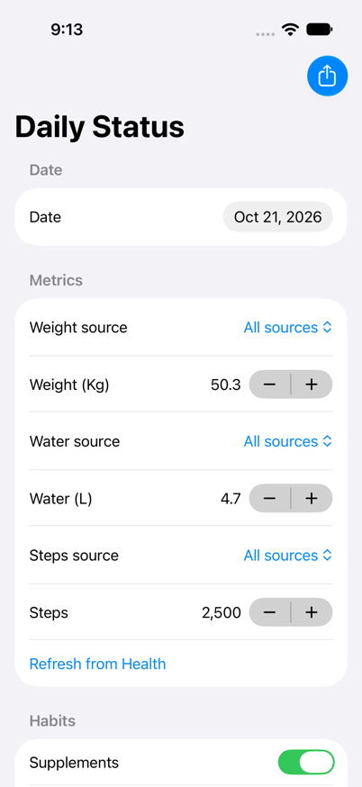
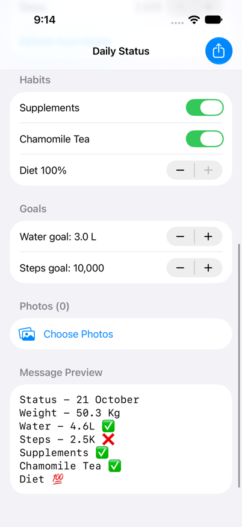
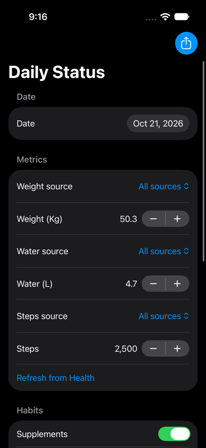

# DayCheck

A small SwiftUI app for logging a daily health check-in and sharing it as a formatted
text message — with photos — to WhatsApp.

<p>
  
  
  
</p>

## What it does

- Pulls **weight**, **water**, and **steps** from Apple Health for the selected day.
  Each metric has its own source picker (e.g. a specific scale, band, or app), or
  "All sources" for Health's combined total — with a manual field/stepper to
  override the fetched value.
- Tracks **Supplements**, **Chamomile Tea**, and a **Diet %** for the day.
- Builds a plain-text status message from those values, e.g.:

  ```
  Status - 21 October
  Weight - 50.3 Kg
  Water - 4.6L ✅
  Steps - 2.5K ❌
  Supplements ✅
  Chamomile Tea ✅
  Diet 💯
  ```

  Water and steps get ✅/❌ against an editable daily goal; Diet shows 💯 at 100%,
  otherwise the percentage.
- Attach photos from your library, with a built-in crop tool (pinch to zoom, drag
  to position) for each one.
- **Share** sends the message and photos to WhatsApp (or any share-sheet target)
  as downsized JPEG files rather than raw in-memory images, which is what makes
  sharing to WhatsApp reliable. On a successful share, the form resets for the
  next day.

## Requirements

- Xcode 27, iOS 27 SDK
- An iPhone or simulator running iOS 27
- HealthKit entitlement (already configured in the project) — grant Health access
  on first launch to pull weight/water/steps

## Project layout

- `MyApp/ContentView.swift` — the form and all UI state
- `MyApp/HealthKitManager.swift` — HealthKit queries (sources, cumulative totals,
  latest sample), with de-duplication for mirrored entries across sources
- `MyApp/StatusEntry.swift` — builds the shareable status message
- `MyApp/PhotoCropView.swift` — the custom square-crop tool
- `MyApp/ShareSheet.swift` — wraps `UIActivityViewController` for text + photos

## Building

Open `Untitled Project.xcodeproj` in Xcode, select the **MyApp** scheme, and run
on a device or simulator.
